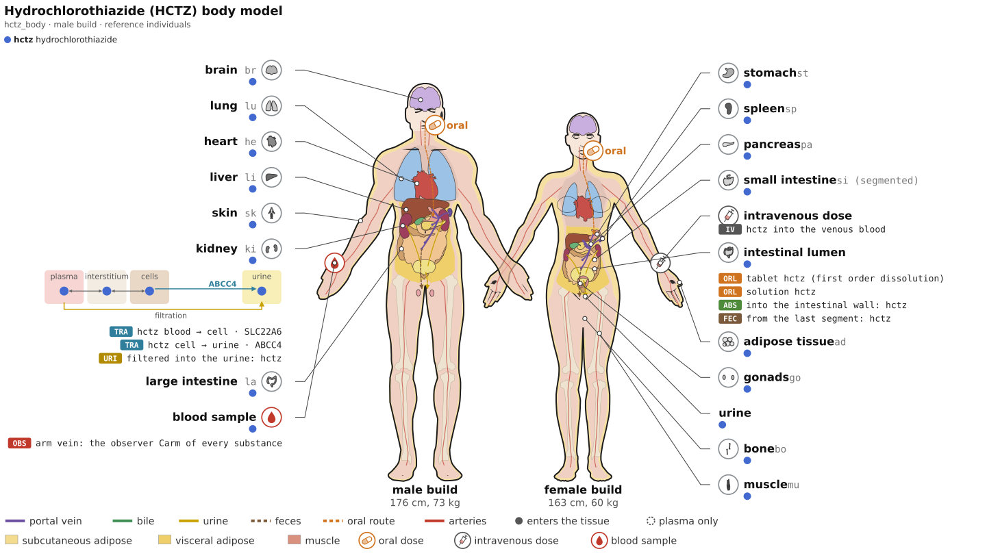
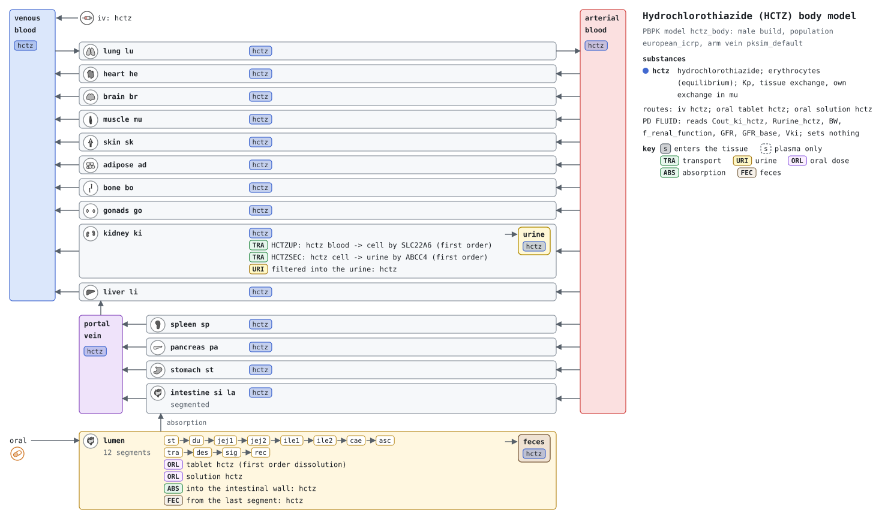

[](https://doi.org/10.5281/zenodo.15427418)
[](https://github.com/matthiaskoenig/hctz-model/releases)
[](https://matthiaskoenig.github.io/hctz-model/)
[](https://github.com/matthiaskoenig/hctz-model/actions/workflows/ci.yml)
[](https://hub.docker.com/r/matthiaskoenig/hctz)
[](https://www.python.org)
[](https://opensource.org/license/MIT)
[](https://creativecommons.org/licenses/by-sa/4.0/)

# Physiologically based pharmacokinetic/pharmacodynamic (PBPK/PD) model of hydrochlorothiazide

This repository provides the hydrochlorothiazide (hctz) physiologically based pharmacokinetic/pharmacodynamic (PBPK/PD) model.

Open the app of the model in your browser, every simulation runs there: <https://matthiaskoenig.github.io/hctz-model/hctz_app.html> (one file, also [`models/hctz_app.html`](models/hctz_app.html))

Documentation: <https://matthiaskoenig.github.io/hctz-model/>

Credibility of the model for its contexts of use: [https://matthiaskoenig.github.io/hctz-model/credibility.html](https://matthiaskoenig.github.io/hctz-model/credibility.html)

## Model





## Quick start

```bash
git clone https://github.com/matthiaskoenig/hctz-model.git && cd hctz-model
uv sync
uv run python -m sbmlsim.run simulate specs/simulate.json --out results/simulate
```

## How to cite

> Schwaiger, A. & König, M. (2026). *Physiologically based pharmacokinetic/pharmacodynamic (PBPK/PD) model of hydrochlorothiazide*. Zenodo. https://doi.org/10.5281/zenodo.15427418

## License

* Source Code: [MIT](https://opensource.org/license/MIT)
* Documentation: [CC BY-SA 4.0](https://creativecommons.org/licenses/by-sa/4.0/)
* Models: [CC BY-SA 4.0](https://creativecommons.org/licenses/by-sa/4.0/)

&copy; 2024-2026 Amanda Schwaiger and Matthias König
