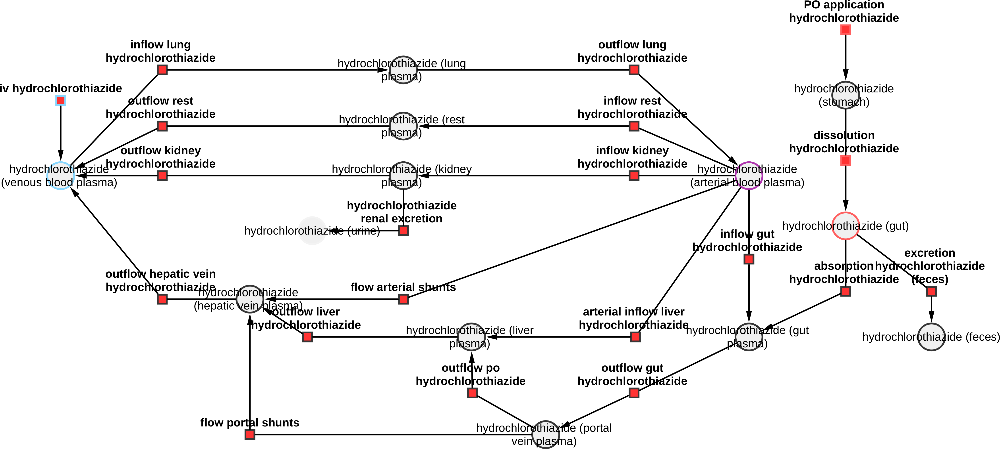
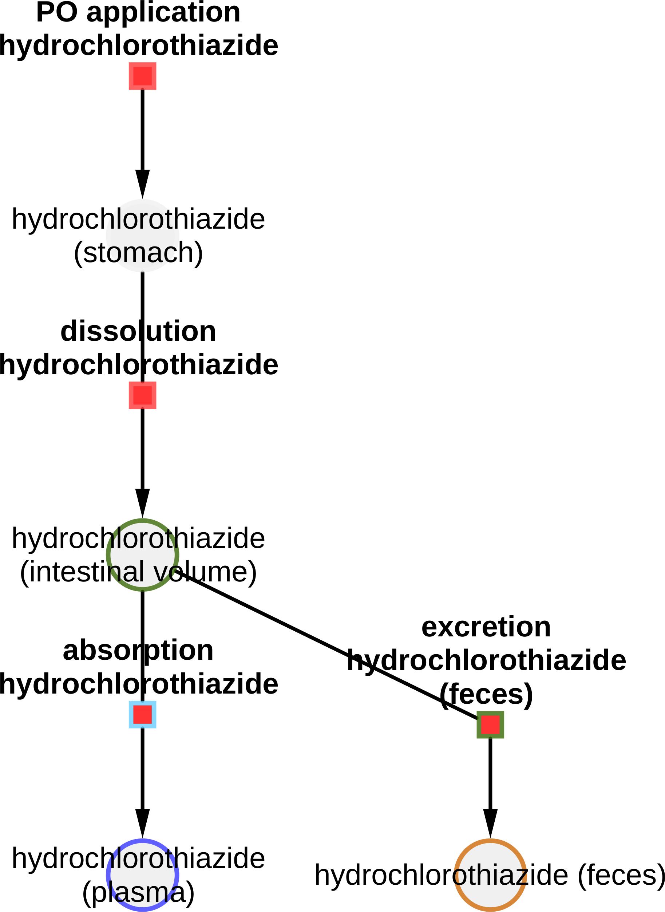
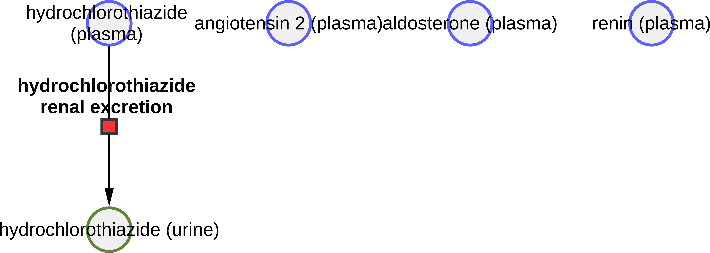

# Models

The models are distributed in [SBML](http://sbml.org) format.

## hctz_body

* Model: [`hctz_body.xml`](https://raw.githubusercontent.com/matthiaskoenig/hctz-model/main/models/hctz_body.xml)
* Equations: [`hctz_body.md`](https://github.com/matthiaskoenig/hctz-model/blob/main/models/hctz_body.md)
* Report: [SBML4humans](https://sbml4humans.de/report?url=https%3A%2F%2Fraw.githubusercontent.com%2Fmatthiaskoenig%2Fhctz-model%2Fmain%2Fmodels%2Fhctz_body.xml)

{ style="max-height: 420px; width: auto; max-width: 100%" }

## hctz_body_flat

* Model: [`hctz_body_flat.xml`](https://raw.githubusercontent.com/matthiaskoenig/hctz-model/main/models/hctz_body_flat.xml)
* Equations: [`hctz_body_flat.md`](https://github.com/matthiaskoenig/hctz-model/blob/main/models/hctz_body_flat.md)
* Report: [SBML4humans](https://sbml4humans.de/report?url=https%3A%2F%2Fraw.githubusercontent.com%2Fmatthiaskoenig%2Fhctz-model%2Fmain%2Fmodels%2Fhctz_body_flat.xml)

## hctz_fluid

* Model: [`hctz_fluid.xml`](https://raw.githubusercontent.com/matthiaskoenig/hctz-model/main/models/hctz_fluid.xml)
* Equations: [`hctz_fluid.md`](https://github.com/matthiaskoenig/hctz-model/blob/main/models/hctz_fluid.md)
* Report: [SBML4humans](https://sbml4humans.de/report?url=https%3A%2F%2Fraw.githubusercontent.com%2Fmatthiaskoenig%2Fhctz-model%2Fmain%2Fmodels%2Fhctz_fluid.xml)

## hctz_intestine

* Model: [`hctz_intestine.xml`](https://raw.githubusercontent.com/matthiaskoenig/hctz-model/main/models/hctz_intestine.xml)
* Equations: [`hctz_intestine.md`](https://github.com/matthiaskoenig/hctz-model/blob/main/models/hctz_intestine.md)
* Report: [SBML4humans](https://sbml4humans.de/report?url=https%3A%2F%2Fraw.githubusercontent.com%2Fmatthiaskoenig%2Fhctz-model%2Fmain%2Fmodels%2Fhctz_intestine.xml)

{ style="max-height: 420px; width: auto; max-width: 100%" }

## hctz_kidney

* Model: [`hctz_kidney.xml`](https://raw.githubusercontent.com/matthiaskoenig/hctz-model/main/models/hctz_kidney.xml)
* Equations: [`hctz_kidney.md`](https://github.com/matthiaskoenig/hctz-model/blob/main/models/hctz_kidney.md)
* Report: [SBML4humans](https://sbml4humans.de/report?url=https%3A%2F%2Fraw.githubusercontent.com%2Fmatthiaskoenig%2Fhctz-model%2Fmain%2Fmodels%2Fhctz_kidney.xml)

{ style="max-height: 420px; width: auto; max-width: 100%" }

## COMBINE archive

The models and the metadata are available as COMBINE archive from [`hctz_model.omex`](https://raw.githubusercontent.com/matthiaskoenig/hctz-model/main/hctz_model.omex).
