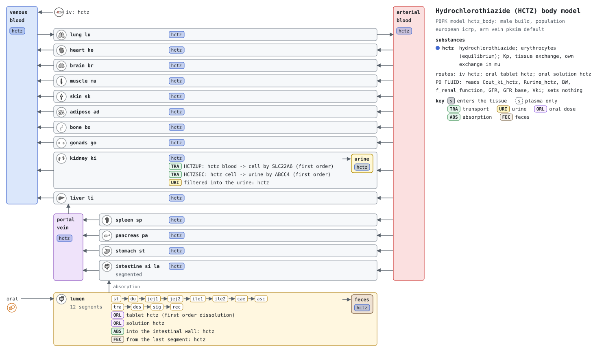

[](https://doi.org/10.5281/zenodo.15427418)

# hydrochlorothiazide (hctz) model
This archive provides the hydrochlorothiazide (hctz) physiologically based pharmacokinetics/ pharmacodynamics (PBPK/PD) model.
The model is developed in the model folder `pkdb_models/models/hctz` of the repository
[pkdb_models](https://github.com/matthiaskoenig/pkdb_models), with its
[documentation](https://matthiaskoenig.github.io/pkdb_models/).

The model is built with the PBPK library `pkpdsim.pbpk` of
[pkpdsim](https://matthiaskoenig.github.io/pkpdsim/) from the definition
`models/definition.py` of the model folder. It is distributed as
[SBML](http://sbml.org) format available from [`hctz_body_flat.xml`](./models/hctz_body_flat.xml) with
corresponding [model equations](./models/hctz_body_flat.md) and [antimony](./models/hctz_body_flat.ant).

The COMBINE archive is available from [`hctz_model.omex`](./hctz_model.omex).

The figure of the model, [`hctz_body.svg`](./models/hctz_body.svg), shows its organs, the routes of
the doses, the substance with its distribution and the processes of the kidney and the intestine;
the PBPK library draws it from the definition.



### Models
* **whole-body** comp model [`hctz_body.xml`](./models/hctz_body.xml): one submodel per organ and the fluid and electrolyte model `FLUID` as PD component; the flattened model [`hctz_body_flat.xml`](./models/hctz_body_flat.xml) is the one which is simulated.
* **fluid** model on its own [`hctz_fluid.xml`](./models/hctz_fluid.xml): the sodium, chloride and water balance with the blood pressure, at the values of the reference individual of the library (but a body weight of 75 kg) and without HCTZ.

## How to cite
[](https://doi.org/10.5281/zenodo.15427418)

> Schwaiger, A. & König, M. (2026).
> *Physiologically based pharmacokinetic/pharmacodynamic (PBPK) model of hctz.*   
> Zenodo. [https://doi.org/10.5281/zenodo.15427418](https://doi.org/10.5281/zenodo.15427418)

## License

* Source Code: [MIT](https://opensource.org/license/MIT)
* Documentation: [CC BY-SA 4.0](https://creativecommons.org/licenses/by-sa/4.0/)
* Models: [CC BY-SA 4.0](https://creativecommons.org/licenses/by-sa/4.0/)

This program is distributed in the hope that it will be useful, but WITHOUT ANY
WARRANTY; without even the implied warranty of MERCHANTABILITY or FITNESS FOR A
PARTICULAR PURPOSE.


## Run simulations
The simulations run from a checkout of the repository
[pkdb_models](https://github.com/matthiaskoenig/pkdb_models) with
[uv](https://docs.astral.sh/uv/getting-started/installation/), see its
[documentation](https://matthiaskoenig.github.io/pkdb_models/):
```bash
git clone https://github.com/matthiaskoenig/pkdb_models.git
cd pkdb_models
uv sync
uv run run_simulation pkdb_models.models.hctz --action all
```
The results are written into `pkdb_models/models/hctz/results/`.

## Funding
Matthias König was supported by the Federal Ministry of Research, Technology and Space (BMFTR, Germany) within ATLAS by grant number 031L0304B and by the German Research Foundation (DFG) within the Research Unit Program FOR 5151 QuaLiPerF (Quantifying Liver Perfusion-Function Relationship in Complex Resection - A Systems Medicine Approach) by grant number 436883643 and by grant number 465194077 (Priority Programme SPP 2311, Subproject SimLivA). This work was supported by the BMBF-funded de.NBI Cloud within the German Network for Bioinformatics Infrastructure (de.NBI) (031A537B, 031A533A, 031A538A, 031A533B, 031A535A, 031A537C, 031A534A, 031A532B).

© 2024-2026 Matthias König, [Systems Medicine of the Liver](https://livermetabolism.com)
